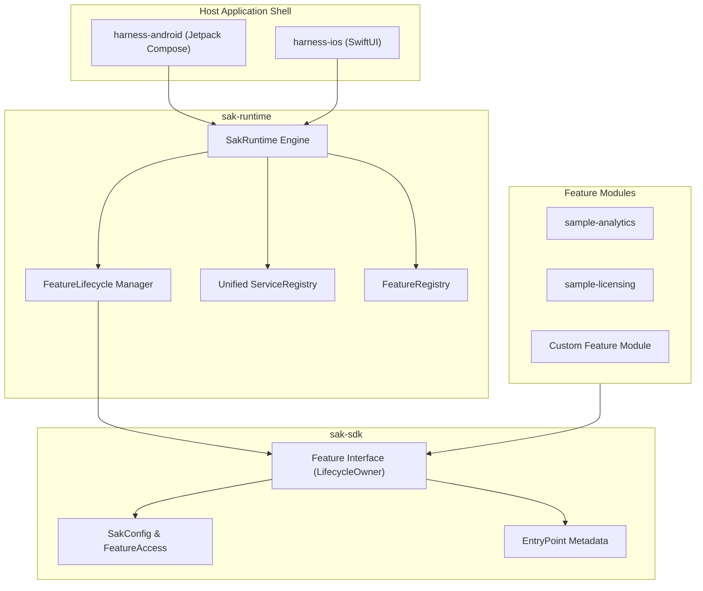

# SAK: Standard Application Kit

**A Protocol-First, UI-Agnostic Kotlin Multiplatform (KMP) Framework for Modular Super-Apps & Micro-Frontends.**

SAK allows independent teams to develop business features in pure Kotlin and host them in a unified, dynamically configurable shell on Android (Jetpack Compose) and iOS (SwiftUI).

---

## 🚀 Key Architectural Principles

- **Protocol-First & UI-Agnostic**: Core SAK contains zero UI view dependencies. Features publish metadata descriptors (`EntryPoint`) into slot categories (`"home"`, `"alerts"`), and host apps decide how to render them using native Compose or SwiftUI.
- **Pure Interface Contracts**: Features implement `interface Feature : LifecycleOwner` directly (`class AnalyticsFeature : Feature`). No forced single-inheritance abstract base classes.
- **Direct Platform Lifecycle Sync**: `Feature` extends `androidx.lifecycle.LifecycleOwner`. Feature lifecycles (`onCreate`, `onConfigChanged`, `onDestroy`) automatically sync with the host platform container (Android `ComponentActivity` / Compose `LocalLifecycleOwner` or SwiftUI scene phase).
- **Dynamic Access & Licensing**: Features reactively respond to configuration updates (`SakConfig` & `FeatureAccess`), adapting entitlements and entry points in real time.
- **Unified Dependency Registry**: Single `ServiceRegistry` for host services and cross-feature APIs.
- **Flexible Feature Discovery**: Choose between explicit code registration or automatic detection via `FeatureRegistry`.

---

## 🏗️ System Overview



---

## 📂 Repository Structure

| Module | Purpose |
| :--- | :--- |
| **`sak-sdk/`** | Pure KMP contracts (`Feature`, `FeatureAccess`, `EntryPoint`, `SakConfig`). |
| **`sak-runtime/`** | Engine orchestrating configuration merging, lifecycles, and `ServiceRegistry`. |
| **`harness-android/`** | Reference Android host application demonstrating Compose UI slot rendering. |
| **`harness-ios/`** | Reference iOS host application demonstrating SwiftUI integration. |
| **`sample-analytics/`** | Sample business feature module. |
| **`sample-licensing/`** | Sample licensing provider feature module. |

---

## 🚦 Quick Start (Android)

```bash
# Build and install the Android harness app
./gradlew :harness-android:installDebug
```

---

## 🗺️ Documentation

- 📐 [Architecture Guide](docs/ARCHITECTURE.md)
- 🔄 [Sequence Flows & Lifecycle](docs/FLOWS.md)
- 🧩 [Feature Developer Guide](docs/GUIDE_FEATURE.md)
- ⚙️ [Configuration & Licensing](docs/CONFIG.md)

---
*Created by san. All rights reserved.*
