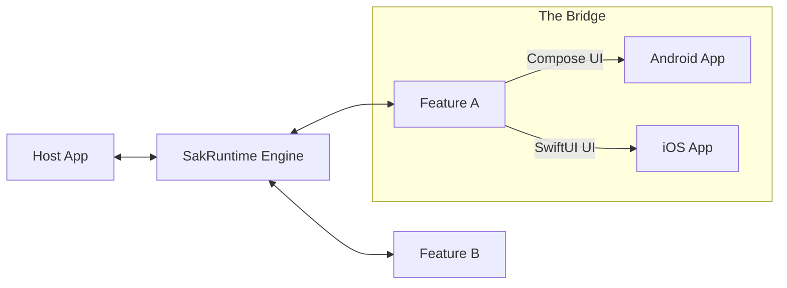

# SAK: Standard Application Kit

**A Protocol-First Kotlin Multiplatform framework for building scalable, modular "Super-Apps".**

SAK allows independent teams to develop business features in pure Kotlin and host them in a unified, dynamically configurable shell on Android (Compose) and iOS (SwiftUI).

---

## 🚀 Key Value Propositions

- **Protocol-First**: The core SDK acts as a lean contract layer. High-fidelity UI is provided through platform-specific bridges.
- **Host-Driven Layout**: The host app owns the navigation and layout, injecting feature widgets into placeholders at runtime.
- **Reactive Licensing**: Features instantly unlock or adapt based on a signed, cryptographically verified license configuration.
- **Resilient Runtime**: Built with a "Sandbox" strategy using `SupervisorJob` to ensure one buggy feature can't crash the whole app.
- **Zero-Maintenance Discovery**: Automated feature registration on iOS using KSP (Kotlin Symbol Processing).

---

## 🏗️ System Overview



---

## 📚 Choose Your Path

| I want to... | Start Here |
| :--- | :--- |
| **Understand the Architecture** | [Architecture Guide](docs/ARCHITECTURE.md) & [Sequence Flows](docs/FLOWS.md) |
| **Build a New Feature** | [Feature Developer Guide](docs/GUIDE_FEATURE.md) |
| **Integrate SAK into a Host App** | [Host Integrator Guide](docs/GUIDE_HOST.md) |
| **Set up a specific platform** | [Android Setup](docs/ANDROID.md) · [iOS Setup](docs/IOS.md) |
| **Understand Config & Licensing** | [Configuration Schema](docs/CONFIG.md) |

---

## 🛠️ Repository Layout

- `sak-sdk/`: Core interfaces, lifecycle definitions, and data models (Pure Kotlin).
- `sak-runtime/`: The engine that manages configuration, lifecycles, and feature instantiation.
- `sak-compose-ui/`: Android/Compose rendering helpers and standard widgets.
- `sak-ios-bridge/`: Headless bridge for native SwiftUI/UIKit integration.
- `sak-ksp-processor/`: Tooling for automated iOS feature discovery.
- `sak-library-debug/`: Observability dashboard to monitor feature health in real-time.
- `sak-harness/`: Reference Android host application.
- `iosSwiftApp/`: Reference iOS host application.

---

## 🚦 Quick Start (Android)

```bash
# Install the demo harness on your device/emulator
./gradlew :sak-harness:installDebug
```

Open the "SAK Observability" dashboard from the home screen to see the live status of all bundled features.

---

## 🗺️ Future Roadmap

See the [ROADMAP.md](docs/ROADMAP.md) for upcoming improvements including type-safe navigation contracts and desktop/web support.

---
*Created by san. All rights reserved.*
