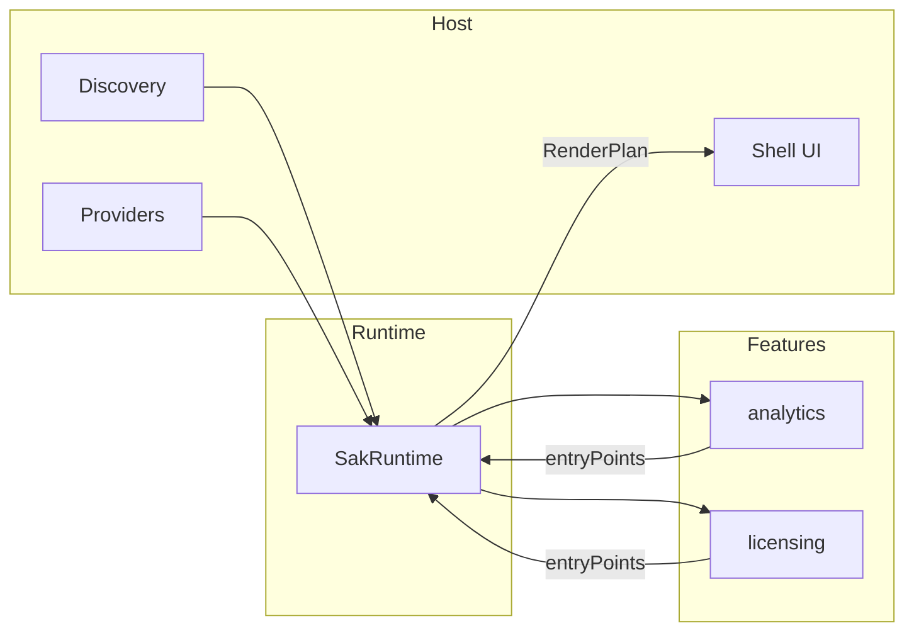
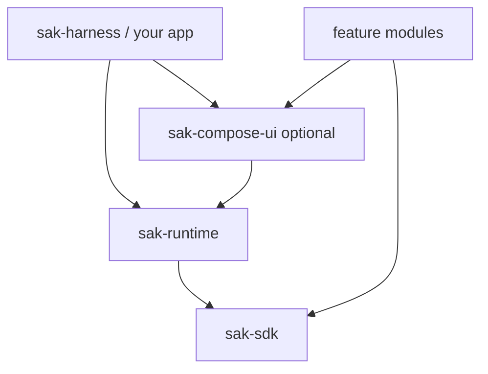
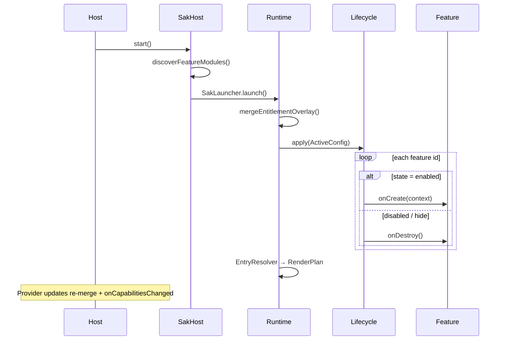
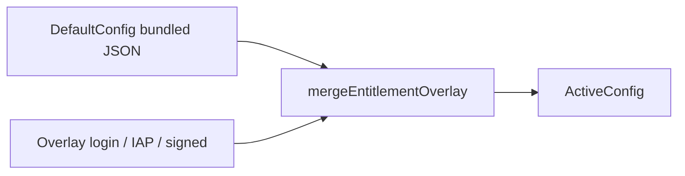

# SAK architecture

Lean multi-feature framework for Kotlin Multiplatform: **entitlement drives load**, **host owns shell**, **features own business**.

**Also:** [config-schema.md](config-schema.md) · [ANDROID.md](ANDROID.md) · [IOS.md](IOS.md)

---

## 1. Three roles (read this first)

| Role | Question they answer | Touches |
|------|----------------------|---------|
| **Host** | How is the app wired? Shell, providers, discovery list | `SakHost`, `SakHostSetup`, shell tabs |
| **Runtime** | What is loaded right now? | `SakRuntime`, merge, lifecycle, `RenderPlan` |
| **Feature** | What does my module expose? | `Feature`, `EntryPoint`, routes, APIs |



**Rule:** entitlement JSON never defines tabs or layout. It only defines **which features load** and **what they may do**.

---

## 2. Module layers

| Module | Responsibility | Compose? |
|--------|----------------|----------|
| **sak-sdk** | Contracts + entitlement types | No |
| **sak-runtime** | Engine: merge, lifecycle, catalog, navigation gate | No |
| **sak-compose-ui** | Reference shell (`SakApp`) — optional | Yes |
| **Feature libs** | Business modules (`sample-analytics`, …) | Yes (their screens) |



---

## 3. Two pipelines (do not confuse them)

### A. Discovery — “what is installed?”

Build time / classpath. Does **not** load features.

| Platform | Mechanism |
|----------|-----------|
| Android | `ServiceLoader` + `META-INF/services/sak.sdk.bundle.FeatureModule` |
| iOS | Manual `List<FeatureModule>` in host |

```kotlin
discoverFeatureModules(manualModules = listOf(AnalyticsFeatureModule, …))
```

### B. Entitlement — “what may run?”

Runtime. Reads **AppConfig** (bundled default + overlay).

| `FeatureState` | Runtime |
|----------------|---------|
| `enabled` | `Feature.onCreate()` |
| `disabled` | `onDestroy()` — host may show locked UI |
| `hide` | `onDestroy()` — host hides surfaces |

```json
"analytics": {
  "state": "enabled",
  "capabilities": ["analytics.summary"],
  "settings": { }
}
```

A feature can be **discovered** but **not loaded** if `state` is not `enabled`.

---

## 4. Host integration (minimal path)

```kotlin
val licenseProvider = SampleLicenseProvider()
LicensingFeatureModule.licenseProvider = licenseProvider  // if module needs same instance

val host = SakHost(
    scope = appScope,
    setup = SakHostSetup(
        defaultConfig = bundledConfig,
        bundledModules = listOf(AnalyticsFeatureModule, …),
        licenseProvider = licenseProvider,
        entitlementProvider = myEntitlementProvider,
        appServices = AppServiceRegistry(mapOf(LogService::class to logService)),
    ),
)
val runtime = host.start()
```

**Compose:** `SakApp(runtime, featureNavContributors = host.modules().navContributors())`

**Without Compose:** observe `RenderPlan` in Swift/UIKit (`SakIosHost` pattern).

---

## 5. Launch sequence



**Providers**

| Type | Use when |
|------|----------|
| `EntitlementConfigProvider` | Login / IAP / backend JSON (unsigned) — preferred |
| `LicenseProvider` | Signed payloads + verifier |

---

## 6. SDK package map (who reads what)

| Package | For | Key types |
|---------|-----|-----------|
| `sak.sdk.bundle` | Host + feature registration | `FeatureModule` |
| `sak.sdk.config` | Host + runtime | `AppConfig`, `ConfigJson`, merge |
| `sak.sdk.license` | Host | `LicenseInfo`, providers, `FeatureEntitlement` |
| `sak.sdk.feature` | Feature teams | `Feature`, `FeatureContext`, `FeatureConfig`, `FeatureState` |
| `sak.sdk.entry` | Feature teams | `EntryPoint`, `EntryKind`, `EntryAction` |
| `sak.sdk.navigation` | Feature teams | `Route`, `RouteGuard` |
| `sak.sdk.api` / `service` | Feature + host | `FeatureApi`, `AppServiceLookup` |

### Host setup vs feature runtime

| | `SakHostSetup` | `FeatureContext` |
|--|----------------|------------------|
| **When** | App launch | While feature is loaded |
| **Contains** | Config, providers, services, module list | Capabilities, settings flows, navigate, APIs |

### Module vs instance

| | `FeatureModule` | `Feature` |
|--|-----------------|-----------|
| **Lifetime** | App install | Loaded instance |
| **Factory** | `create()` — no host args | `onCreate(context)` |

---

## 7. Entry points & shell

Features publish **descriptors**, not views:

```kotlin
EntryPoint(
    id = EntryPointId("summary-card"),
    kind = EntryKind.Card,
    tags = setOf("home"),           // host placement hint
    priority = 10,
    action = EntryAction.Navigate("analytics/today"),
)
```

Runtime builds **`RenderPlan`**:

- `entries` — flat list from loaded features
- `byTag` / `entriesForTag("home")` — for shell tabs

**Shell** (tabs, bottom bar) is **host-owned**:

- Compose: `HostShellDestination` + `SakApp(shellDestinations = …)` in `sak-compose-ui`
- Native: host defines tabs, calls `entriesForTag(tabId)`

---

## 8. Navigation

One shared graph:

- Scaffold routes: `scaffold/home` (reference `SakApp`)
- Feature routes: `analytics/today`, `licensing/upgrade`
- Entry tap → `EntryAction.Navigate` / `DeepLink`
- In-feature → `FeatureContext.navigate(Route)`
- Runtime → `navigationRoute` one-shot `StateFlow`

`NavigationGate` evaluates `RouteGuard` against live **capabilities** before emitting navigation.

---

## 9. Config merge



Overlay patches **license** + listed **features** (`state`, `capabilities`, shallow-merge `settings`). No scaffold in JSON.

---

## 10. Feature lifecycle

Application-scoped (process lifetime), not Activity / VC lifecycle.

| Callback | When |
|----------|------|
| `onCreate` | `state` → enabled |
| `onDestroy` | `state` → disabled / hide |
| `onCapabilitiesChanged` | Still enabled; capabilities or settings changed |
| `onReset` | User clear-data (optional) |

`FeatureStatus` = feature-reported UI (`setupComplete`, `intro`) — **not** entitlement.

---

## 11. Platform discovery

| | Android | iOS |
|---|---------|-----|
| Auto-discovery | `META-INF/services/…FeatureModule` | None |
| Manual list | Optional merge / override | **Required** |
| UI | `SakApp` or custom | `SakIosHost` or custom |

---

## 12. Ownership matrix

| Owns | Does not own |
|------|----------------|
| **Host:** shell, theme, `DefaultConfig`, providers, verifier (prod), which modules bundled | Feature business logic |
| **Runtime:** merge, load/unload, `RenderPlan`, API registry, route guards | UI widgets |
| **Feature:** routes, `entryPoints`, `FeatureStatus`, settings interpretation | Tab layout, entitlement source |
| **AppConfig:** load policy + capabilities + opaque settings | Scaffold, entry placement |

---

## 13. Source map

| Concern | Location |
|---------|----------|
| Host facade | `sak-runtime/.../SakHost.kt`, `SakHostSetup.kt` |
| Engine | `SakRuntime.kt`, `FeatureLifecycle.kt`, `EntryResolver.kt` |
| Discovery | `bundle/FeatureModuleDiscovery*.kt` |
| Contracts | `sak-sdk/...` |
| Reference UI | `sak-compose-ui/.../SakApp.kt`, `shell/HostShellConfig.kt` |
| Headless iOS | `sak-ios-bridge/.../SakIosHost.kt` |

---

## 14. Design principles (keep complexity down)

1. **Entitlement = load policy only** — no UI chrome in JSON.
2. **Entry tags, not tab names in features** — host maps tags → shell regions.
3. **Discover once, reconcile often** — providers push overlays; runtime diffs lifecycle.
4. **Optional UI** — runtime is usable without `sak-compose-ui`.
5. **Progressive depth** — start with `SakHost` + `FeatureModule`; add guards, APIs, signed license when needed.

---

## Compared to Norton AppSDK

| AppSDK pain | SAK approach |
|-------------|--------------|
| Manual `createFeatures()` + manifest discovery | `FeatureModule` + ServiceLoader / manual list |
| DISABLED but still loaded for upsell | `disabled` = not loaded; host shows locked chrome from `ActiveConfig` |
| Scaffold in license config | Host shell only |
| Fragment entry points | `EntryPoint` data + host renderer |
| One fat toggle type | `FeatureConfig` + `FeatureContext` flows |
