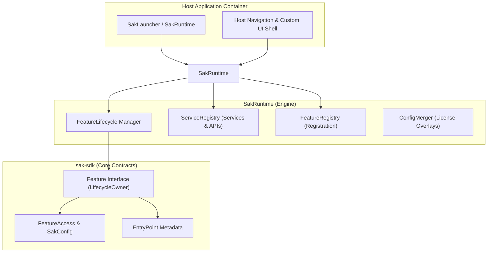

# SAK Architecture & System Design

The **System Architecture Kit (SAK)** is built on a **Protocol-First, UI-Agnostic** philosophy, separating business logic, runtime orchestration, and platform-specific UI rendering.

---

## 1. System Layers



### Layer Responsibilities

| Layer | Responsibility |
| :--- | :--- |
| **`sak-sdk`** | **Pure Kotlin Contracts**. Defines `Feature`, `FeatureAccess`, `EntryPoint`, `SakConfig`, and `ServiceLookup`. Contains zero UI code. |
| **`sak-runtime`** | **The Orchestrator**. Handles configuration merging, feature instantiation, platform lifecycle binding, and unified service lookups. |
| **Host Application** | **The Container**. Owns application navigation, tab bars, and UI slot rendering using native Jetpack Compose (`harness-android`) or SwiftUI (`harness-ios`). |
| **Feature Modules** | **Micro-Frontends**. Independent business modules implementing `Feature`. |

---

## 2. Feature Contract & Lifecycle

Features implement `interface Feature : LifecycleOwner` directly.

```kotlin
interface Feature : LifecycleOwner {
    val id: FeatureId
    val status: StateFlow<FeatureStatus>
    val entryPoints: StateFlow<List<EntryPoint>>
    val routes: List<Route>

    suspend fun onCreate(context: FeatureContext) {}
    suspend fun onConfigChanged(access: FeatureAccess) {}
    suspend fun onDestroy() {}
}
```

### 3 Lifecycle Phases
1. **`onCreate(context: FeatureContext)`**: Called when feature is instantiated and bound to platform lifecycle.
2. **`onConfigChanged(access: FeatureAccess)`**: Called when license overlays or feature entitlements update.
3. **`onDestroy()`**: Called when feature is deactivated or runtime shuts down.

---

## 3. Platform Lifecycle Sync
Neither features nor host apps need to extend `ComponentActivity`. Feature lifecycles bind directly to `androidx.lifecycle.LifecycleOwner`:
- **Android**: Host passes `LocalLifecycleOwner.current.lifecycle` or `Activity.lifecycle` to `SakRuntime`.
- **iOS**: Host passes SwiftUI `scenePhase` / view controller lifecycle events into `SakRuntime`.

Features observe platform lifecycle events (`ON_START`, `ON_RESUME`, `ON_PAUSE`, `ON_STOP`) directly via standard Jetpack observers (`LifecycleEventObserver`, `coroutineScope`).

---

## 4. Configuration & Access Model

The runtime configuration is represented by `SakConfig`:

```kotlin
data class SakConfig(
    val version: Int = 1,
    val features: Map<String, FeatureAccess> = emptyMap(),
)
```

Each feature reads its `FeatureAccess` entitlement snapshot:
- `enabled`: Boolean toggle for activation.
- `plan`: Tier string (e.g. `"trial"`, `"pro"`).
- `grants`: Capability set granted by license overlays (e.g., `setOf("analytics.reports")`).
- `attrs`: Opaque JSON attribute map.

---

## 5. Feature Discovery & Registration

SAK supports two registration styles via `FeatureRegistry`:

### Option A: Explicit Registration (Recommended)
```kotlin
val runtime = SakRuntime(
    defaultConfig = defaultConfig,
    featureRegistry = FeatureRegistry.of(
        AnalyticsFeature(),
        LicensingFeature(licenseProvider)
    ),
    scope = appScope,
    hostLifecycle = hostLifecycle
)
```

### Option B: Automatic Discovery
```kotlin
val runtime = SakRuntime(
    featureRegistry = FeatureRegistry.discover()
)
```

---

## 6. Service & API Lookup

Host services and feature-provided APIs are unified in `ServiceRegistry`:

```kotlin
interface ServiceLookup {
    fun <T : Any> find(type: KClass<T>): T?
    fun <T : Any> require(type: KClass<T>): T
}
```

Features access services via `context.services.require<MyService>()`.
