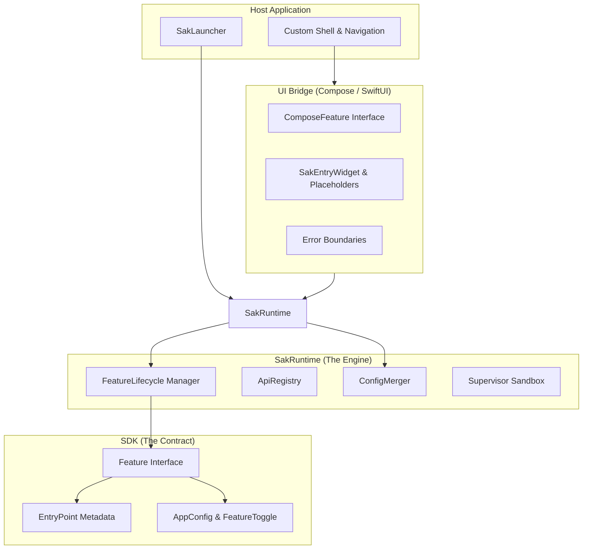

# SAK Architecture

The SAK (System Architecture Kit) is built on a **Protocol-First** philosophy, emphasizing the separation between business logic, orchestration, and platform-specific rendering.

---

## 1. System Layers

| Layer | Responsibility |
| :--- | :--- |
| **SDK** | **Pure Kotlin Contracts**. Defines the data structures, lifecycle methods, and common utilities used by both hosts and features. |
| **Runtime** | **The Orchestrator**. Handles the reactive merging of configurations, manages feature instantiation (including Lazy Loading), and provides the sandbox supervisor. |
| **UI Bridge** | **The Renderer**. Provides the glue between common logic and platform UI. It handles filtering entries into placeholders and isolating UI crashes. |
| **Host** | **The Container**. Defines the visual framework of the app (tabs, menus) and provides platform-level services (Auth, Storage) to features. |

---

## 2. Resilience & The Sandbox
SAK is designed for stability. Features do not run directly on the main application thread without protection.

- **SupervisorJob**: Every feature lifecycle call is wrapped in a supervisor. If one feature crashes during `onCreate`, the runtime catches it, marks it as `FeatureState.Error`, and continues with other features.
- **Managed Scopes**: Each feature is provided with its own `CoroutineScope`. This scope is automatically cancelled when the feature is deactivated or the app shuts down, preventing memory leaks.

---

## 3. Performance & Lazy Loading
To ensure a fast startup time even with hundreds of features, SAK supports **Loading Tiers**.

- **Startup**: Features essential for the initial experience are loaded immediately.
- **Lazy**: Features are only instantiated when their `EntryPoint` is about to be rendered or their API is requested by another feature.

---

## 4. Automation via KSP
On iOS, SAK eliminates manual registration through Kotlin Symbol Processing. The compiler scans for the `@SakModule` annotation and generates the static registry needed for the Swift bridge, providing a "Zero-Config" developer experience.
