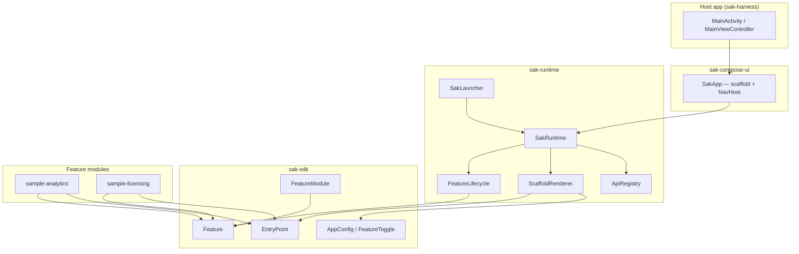
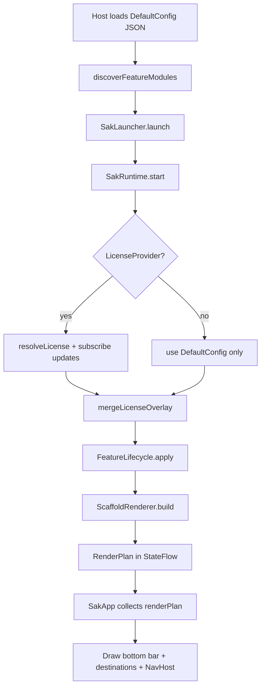
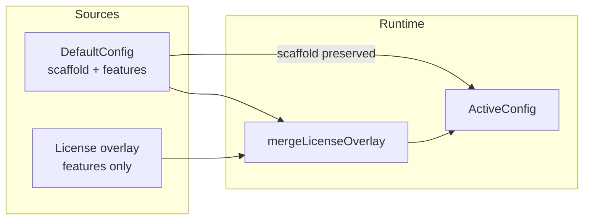
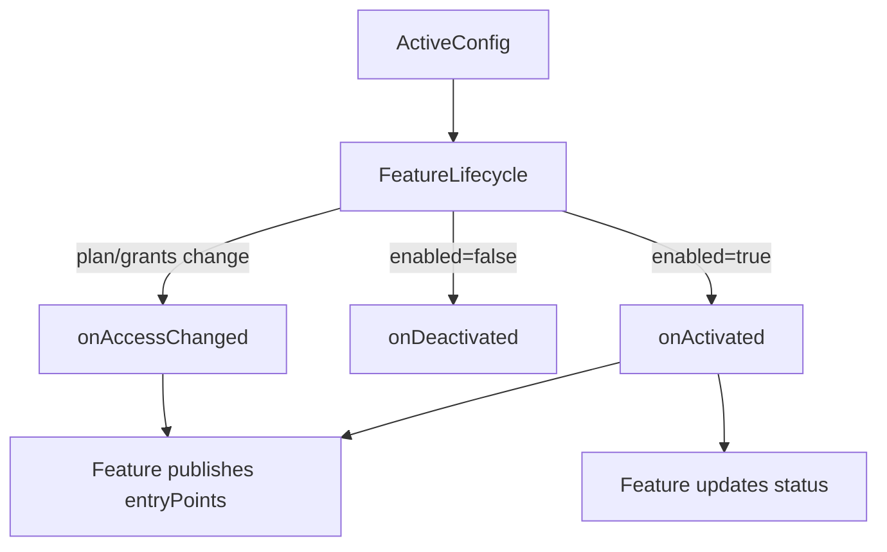
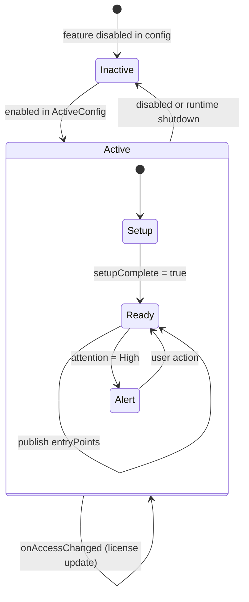
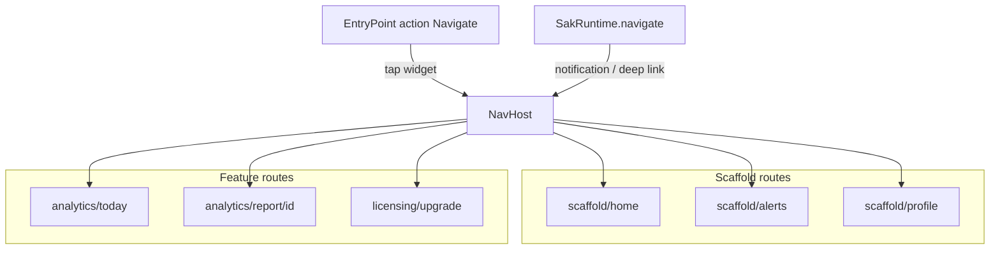
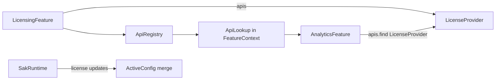
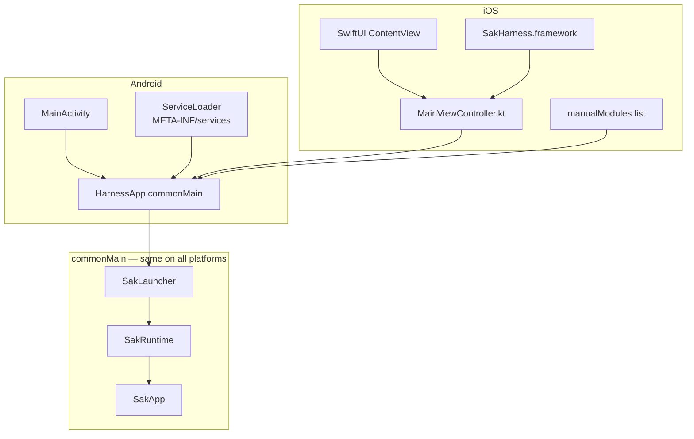
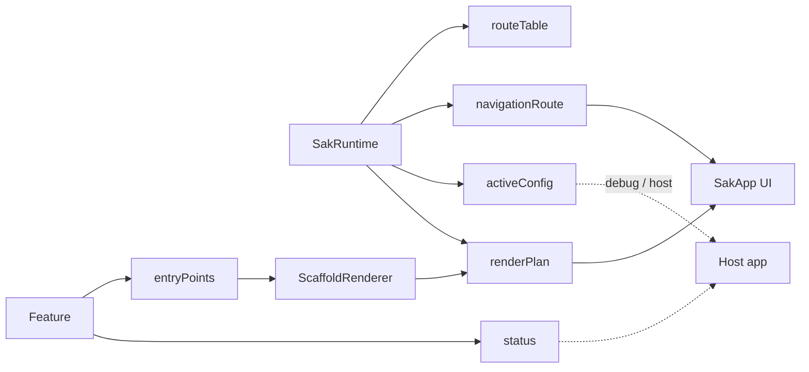
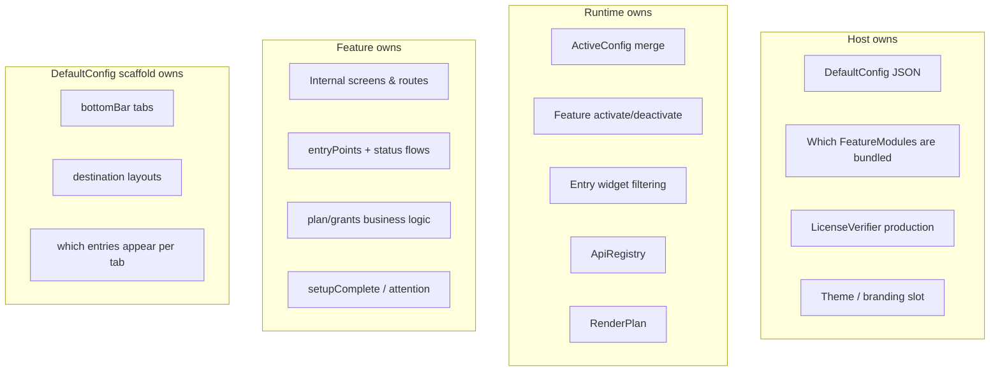

# SAK architecture — SDK & runtime

Visual guide to how `sak-sdk`, `sak-runtime`, and `sak-compose-ui` work together on Android and iOS.

**Related:** [config-schema.md](config-schema.md) · [ANDROID.md](ANDROID.md) · [IOS.md](IOS.md)

---

## 1. Module layers

`sak-sdk` has **no Compose** — pure contracts. `sak-runtime` implements the engine. UI lives in `sak-compose-ui` and feature modules.



| Module | Responsibility |
|--------|----------------|
| **sak-sdk** | `Feature`, `FeatureStatus`, config types, `EntryPoint`, `FeatureModule`, license contracts |
| **sak-runtime** | Config merge, activate/deactivate features, build `RenderPlan`, API registry, navigation signals |
| **sak-compose-ui** | `SakApp` — bottom bar, scaffold destinations, single `NavHost` |
| **Feature module** | Business logic, entry widgets, internal screens, optional `FeatureApi` |

---

## 2. Launch flow (host → runtime → UI)

Same sequence on Android and iOS. Platform code only provides the Compose root.



**Host code pattern** (`HarnessApp.kt`):

1. `discoverFeatureModules(...)` → list of `FeatureModule`
2. `SakLauncher(scope).launch(defaultConfig, featureModules, deps)` → `SakRuntime`
3. `SakApp(runtime, featureNavContributors = modules.navContributors(deps))`

---

## 3. Config merge

Scaffold comes **only** from DefaultConfig. License overlay updates **features** only.





---

## 4. Feature lifecycle

Lifecycle is **application-scoped** (process lifetime), not Activity / UIViewController lifecycle.



| Callback | When |
|----------|------|
| `onActivated` | Feature becomes `enabled` — start init, register screens, publish entry points |
| `onAccessChanged` | `plan`, `grants`, or `entries` changed (usually license) |
| `onDeactivated` | Feature disabled or app shutting down — clear flows, release resources |
| `onReset` | User clear-data — wipe feature local state |

**Readiness:** feature sets `FeatureStatus.setupComplete`. Config `enabled` turns the feature on; `setupComplete` means it is safe to use.

---

## 5. Scaffold & entry points

Config defines **where** widgets appear. Features define **what** widgets exist.

```mermaid
flowchart TB
    subgraph Config["default-config.json scaffold"]
        BB[bottomBar: home, alerts, profile]
        DEST[destinations per tab]
        SEC[sections: entries | query]
    end

    subgraph Feature["Active feature"]
        EPL[entryPoints StateFlow]
        ST[status StateFlow]
    end

    subgraph Runtime["ScaffoldRenderer"]
        RP[RenderPlan]
    end

    subgraph UI["SakApp"]
        NAV[NavigationBar from bottomBar]
        TAB[Scaffold destination screens]
        W[Entry widgets sorted by priority]
    end

    BB --> NAV
    DEST --> SEC
    SEC -->|entries refs| EPL
    SEC -->|query categories| EPL
    EPL --> RP
    RP --> TAB
    RP --> W
    ST -.->|future: badges| NAV
```

**Section types:**

| Type | Config | Runtime behavior |
|------|--------|------------------|
| `entries` | Explicit `{ feature, entry }` refs | Resolve that one widget |
| `query` | `categories: ["alerts"]` | Collect all entry points matching category |

**Alerts example:** feature publishes `EntryPoint(categories = setOf("alerts"))` → Alerts tab query section picks it up.

---

## 6. Navigation (one NavHost)

Scaffold routes and feature routes live in the **same** navigation graph.



Features register routes via `FeatureNavigationModule.navContributor` when the host builds `SakApp`.

---

## 7. Feature APIs & cross-feature calls



Licensing feature exposes `LicenseProvider` as a `FeatureApi`. Runtime subscribes to license updates and re-merges config.

---

## 8. Android vs iOS hosting

Runtime and `SakApp` are **identical**. Only the native shell and feature discovery differ.



| | Android | iOS |
|---|---------|-----|
| Entry | `MainActivity` | `MainViewController()` in framework |
| Feature discovery | `ServiceLoader` + optional manual list | **Manual** `FeatureModule` list only |
| Build | Gradle → APK | Gradle → framework + Xcode links |
| iOS targets | — | `iosSimulatorArm64`, `iosArm64` |

---

## 9. Data flows (StateFlows)

What Compose observes from the runtime:



---

## 10. Quick reference — who owns what



---

## Source code map

| Concept | Primary files |
|---------|----------------|
| Contracts | `sak-sdk/.../Feature.kt`, `FeatureStatus.kt`, `EntryPoint.kt`, `AppConfig.kt` |
| Engine | `sak-runtime/.../SakRuntime.kt`, `FeatureLifecycle.kt`, `ScaffoldRenderer.kt` |
| Launch | `sak-runtime/.../SakLauncher.kt` |
| UI shell | `sak-compose-ui/.../SakApp.kt` |
| Harness | `sak-harness/.../HarnessApp.kt` |
| iOS entry | `sak-harness/.../MainViewController.kt` |
| iOS modules | `sak-harness/.../HarnessBundledFeatures.kt` |
