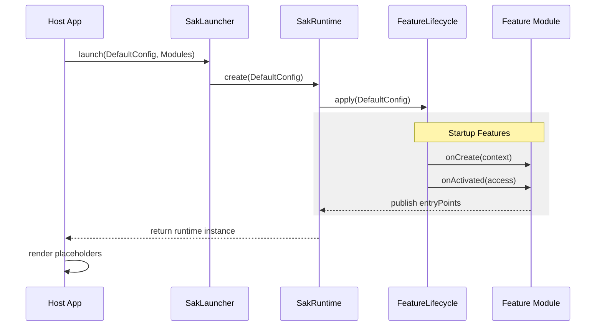
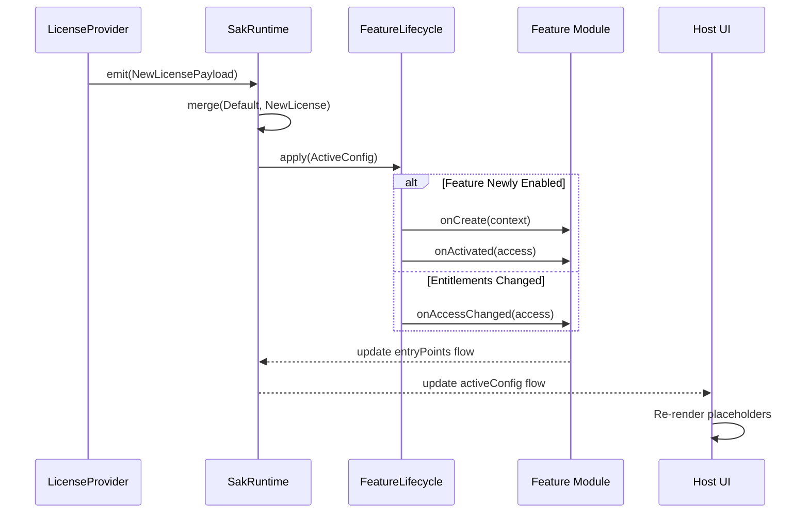
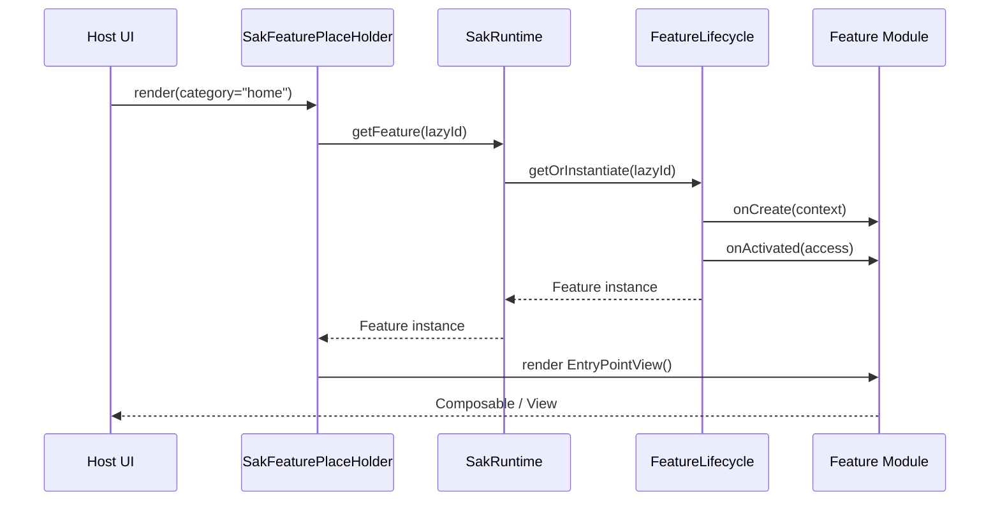
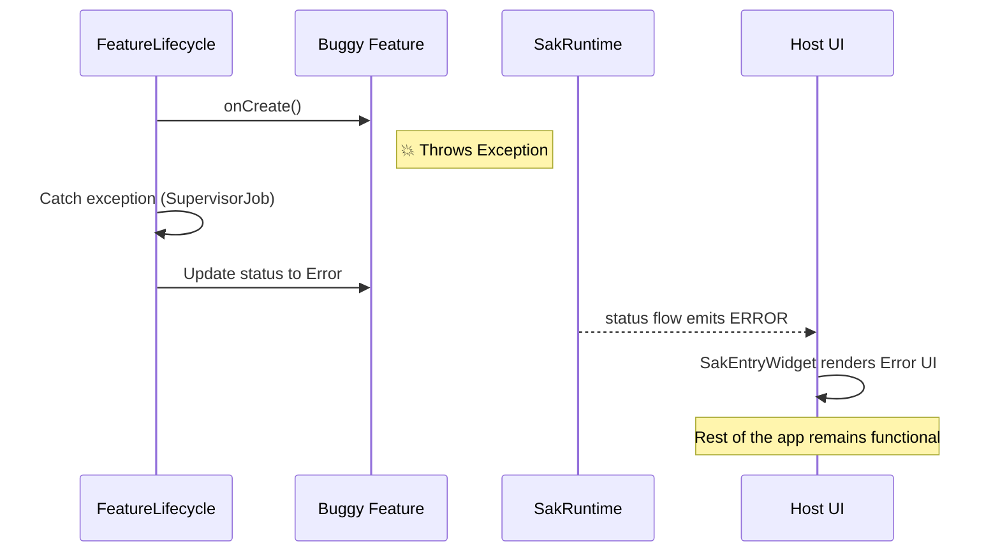

# SAK Dynamic Flows

This document details the reactive behaviors of the SAK framework using sequence diagrams.

---

## 1. System Boot Sequence
This flow shows how the host initializes the SAK runtime and how features are created and activated.

---

## 2. Reactive License Update
Shows what happens when a user upgrades their license while the app is running.

---

## 3. Just-In-Time Lazy Loading
Shows the flow when a feature marked as `LoadingPriority.Lazy` is accessed for the first time.

---

## 4. Error Isolation (Sandbox)
Shows how a failure in one feature is isolated to prevent a global crash.

