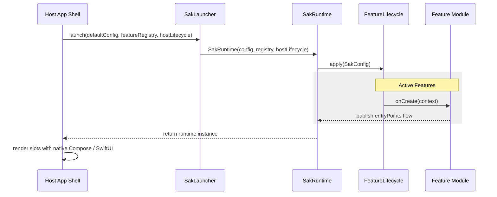
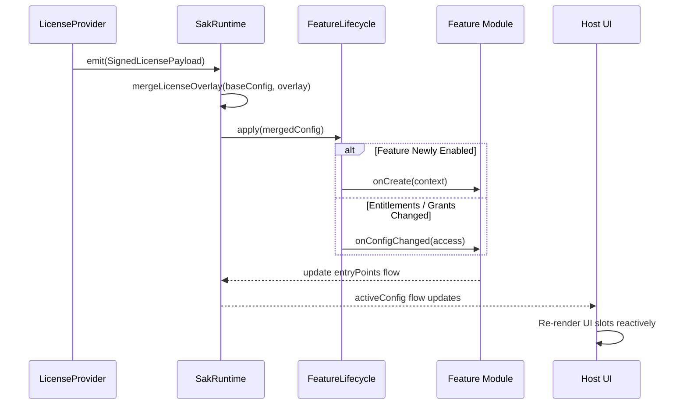
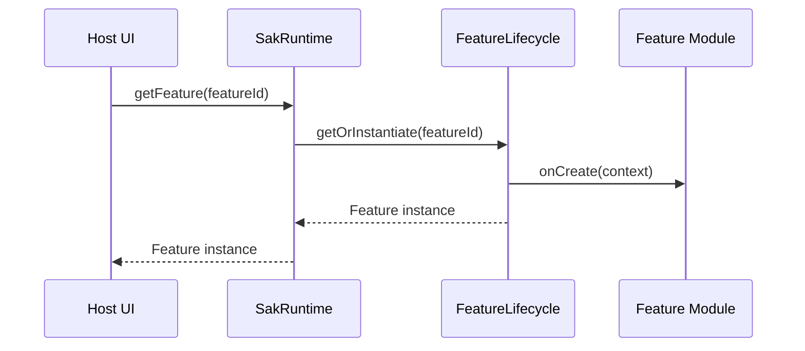
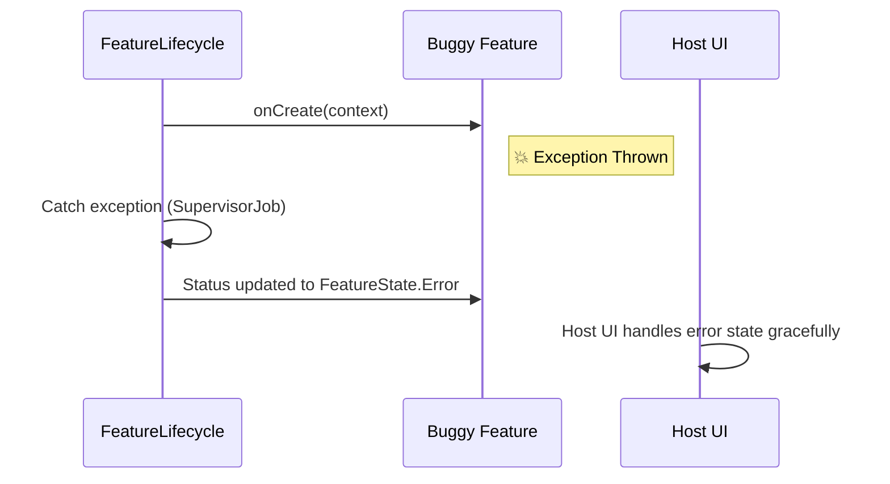

# SAK Dynamic Flows & Sequence Diagrams

This document details the reactive behaviors and lifecycle flows of the SAK framework.

---

## 1. System Boot Sequence

Shows how the host application initializes `SakRuntime`, binds platform lifecycle, and initializes features.

---

## 2. Reactive License Overlay Update

Shows what happens when a user upgrades their license tier or unlocks new entitlements at runtime.

---

## 3. Just-In-Time Lazy Loading

Shows the flow when a lazy feature is accessed for the first time by slot category query or service lookup.

---

## 4. Error Isolation (Sandbox)

Shows how failures in a single feature are isolated using `SupervisorJob`.

