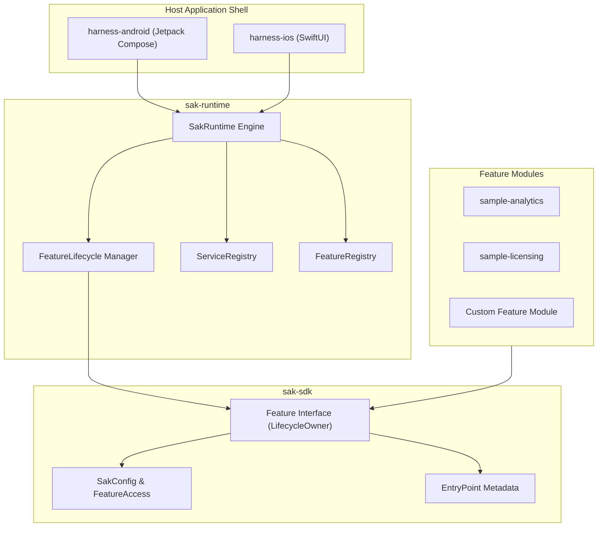

# SAK Complete Master Guide & File Reference

This document is the end-to-end, comprehensive guide for understanding, extending, and integrating the **Standard Application Kit (SAK)** framework. It explains every single file in the repository, its specific use case, and provides step-by-step instructions for building features and host applications on Android and iOS.

---

## 📖 Table of Contents

1. [System Overview & Concept](#1-system-overview--concept)
2. [Complete Repository File Dictionary](#2-complete-repository-file-dictionary)
   - [Core SDK (`sak-sdk`)](#a-core-sdk-sak-sdk)
   - [Runtime Engine (`sak-runtime`)](#b-runtime-engine-sak-runtime)
   - [Android Host (`harness-android`)](#c-android-reference-host-harness-android)
   - [iOS Host (`harness-ios`)](#d-ios-reference-host-harness-ios)
   - [Sample Feature Modules](#e-sample-feature-modules)
3. [Step-by-Step Guide: Building a New Feature Module](#3-step-by-step-guide-building-a-new-feature-module)
4. [Step-by-Step Guide: Android Host Integration (Jetpack Compose)](#4-step-by-step-guide-android-host-integration-jetpack-compose)
5. [Step-by-Step Guide: iOS Host Integration (SwiftUI)](#5-step-by-step-guide-ios-host-integration-swiftui)
6. [Dynamic Licensing & Entitlement Overlays](#6-dynamic-licensing--entitlement-overlays)

---

## 1. System Overview & Concept

SAK is a **Protocol-First, UI-Agnostic Kotlin Multiplatform (KMP) framework** designed for building **Super-Apps** and **Micro-Frontends**.



### Core Architecture Pillars
- **Zero UI Dependencies in SDK**: SAK provides data contracts (`EntryPoint`). Host apps render UI using native Compose or SwiftUI.
- **Pure Interface Features**: Features implement `interface Feature : LifecycleOwner` directly (`class MyFeature : Feature`).
- **Platform Lifecycle Sync**: Feature lifecycles (`onCreate`, `onConfigChanged`, `onDestroy`) sync directly with Android `ComponentActivity` or SwiftUI scene phase.
- **Dynamic Access & Licensing**: Features reactively respond to entitlement updates (`SakConfig` & `FeatureAccess`).

---

## 2. Complete Repository File Dictionary

### A. Core SDK (`sak-sdk`)
Contains pure KMP interfaces, lifecycle definitions, and configuration models.

| File Path | Description & Use Case |
| :--- | :--- |
| [`Feature.kt`](file:///home/san/Projects/SAK/sak-sdk/src/commonMain/kotlin/sak/sdk/feature/Feature.kt) | Core contract for feature modules. Extends `LifecycleOwner` and declares `onCreate`, `onConfigChanged`, `onDestroy`, `status`, `entryPoints`, and `routes`. |
| [`BaseFeature.kt`](file:///home/san/Projects/SAK/sak-sdk/src/commonMain/kotlin/sak/sdk/feature/BaseFeature.kt) | Optional helper base class providing backing `MutableStateFlow`s for `status` and `entryPoints`. |
| [`FeatureContext.kt`](file:///home/san/Projects/SAK/sak-sdk/src/commonMain/kotlin/sak/sdk/feature/FeatureContext.kt) | Runtime handle passed to active features. Grants access to `services`, `access`, `navigate`, and `coroutineScope`. |
| [`FeatureAccess.kt`](file:///home/san/Projects/SAK/sak-sdk/src/commonMain/kotlin/sak/sdk/config/FeatureAccess.kt) | Snapshot of a feature's entitlements: `enabled`, `plan`, `grants`, `entries`, `routes`, `attrs`. |
| [`SakConfig.kt`](file:///home/san/Projects/SAK/sak-sdk/src/commonMain/kotlin/sak/sdk/config/SakConfig.kt) | Root JSON configuration document mapping feature IDs to `FeatureAccess`. |
| [`ConfigMerger.kt`](file:///home/san/Projects/SAK/sak-sdk/src/commonMain/kotlin/sak/sdk/config/ConfigMerger.kt) | Merges signed license overlay configs into base defaultConfig. |
| [`EntryPoint.kt`](file:///home/san/Projects/SAK/sak-sdk/src/commonMain/kotlin/sak/sdk/entry/EntryPoint.kt) | Data descriptor for widgets published by features into host slot categories. Includes `id`, `type` (`EntryPointType`), `style`, `action`, `priority`, `categories`. |
| [`EntryAction.kt`](file:///home/san/Projects/SAK/sak-sdk/src/commonMain/kotlin/sak/sdk/entry/EntryAction.kt) | Sealed class defining click actions: `Navigate`, `DeepLink`, `None`, `Custom`. |
| [`EntryStyle.kt`](file:///home/san/Projects/SAK/sak-sdk/src/commonMain/kotlin/sak/sdk/entry/EntryStyle.kt) | Enum for visual layout hints: `Card`, `Row`, `Tile`, `Banner`, `Widget`, `Custom`. |
| [`ServiceLookup.kt`](file:///home/san/Projects/SAK/sak-sdk/src/commonMain/kotlin/sak/sdk/service/ServiceLookup.kt) | Unified lookup container for retrieving host services and cross-feature APIs by `KClass`. |
| [`FeatureService.kt`](file:///home/san/Projects/SAK/sak-sdk/src/commonMain/kotlin/sak/sdk/service/FeatureService.kt) | Typed interface wrapper for exporting a service/API from a feature. |
| [`LicenseProvider.kt`](file:///home/san/Projects/SAK/sak-sdk/src/commonMain/kotlin/sak/sdk/license/LicenseProvider.kt) | Contract for license sources emitting `SignedLicensePayload` updates. |
| [`FeatureModule.kt`](file:///home/san/Projects/SAK/sak-sdk/src/commonMain/kotlin/sak/sdk/bundle/FeatureModule.kt) | Factory interface for lazy feature module creation with `SakDependencies`. |
| [`Route.kt`](file:///home/san/Projects/SAK/sak-sdk/src/commonMain/kotlin/sak/sdk/navigation/Route.kt) | Simple value wrapper for navigation route strings (e.g. `Route("analytics/today")`). |

---

### B. Runtime Engine (`sak-runtime`)
Handles orchestration, lifecycle binding, config merging, and dependency containers.

| File Path | Description & Use Case |
| :--- | :--- |
| [`SakRuntime.kt`](file:///home/san/Projects/SAK/sak-runtime/src/commonMain/kotlin/sak/runtime/SakRuntime.kt) | Application-scoped engine. Wires config, `FeatureLifecycle`, `ServiceRegistry`, `FeatureRegistry`, and one-shot navigation signals (`navigationRoute`). |
| [`FeatureLifecycle.kt`](file:///home/san/Projects/SAK/sak-runtime/src/commonMain/kotlin/sak/runtime/FeatureLifecycle.kt) | Reconciles active features against config and syncs feature lifecycles with the host platform container. |
| [`FeatureRegistry.kt`](file:///home/san/Projects/SAK/sak-runtime/src/commonMain/kotlin/sak/runtime/FeatureRegistry.kt) | Registry managing feature instances/factories (`FeatureRegistry.of(...)` or `FeatureRegistry.discover()`). |
| [`ServiceRegistry.kt`](file:///home/san/Projects/SAK/sak-runtime/src/commonMain/kotlin/sak/runtime/ServiceRegistry.kt) | Dependency container storing host services and feature APIs into unified `ServiceLookup`. |
| [`SakLauncher.kt`](file:///home/san/Projects/SAK/sak-runtime/src/commonMain/kotlin/sak/runtime/SakLauncher.kt) | Bootstrap launcher helper for initializing `SakRuntime`. |

---

### C. Android Reference Host (`harness-android`)
Reference Android application (`sak-harness`).

| File Path | Description & Use Case |
| :--- | :--- |
| [`HarnessApp.kt`](file:///home/san/Projects/SAK/sak-harness/src/commonMain/kotlin/sak/harness/HarnessApp.kt) | Android harness root composable. Boots `SakRuntime` and renders UI slot categories via `ComposeFeatureSlot`. |
| [`HarnessBundledFeatures.kt`](file:///home/san/Projects/SAK/sak-harness/src/commonMain/kotlin/sak/harness/HarnessBundledFeatures.kt) | Creates `FeatureRegistry` bundling sample features (`AnalyticsFeature`, `LicensingFeature`, `DebugFeature`, `HarnessDemoFeature`). |
| [`DebugFeature.kt`](file:///home/san/Projects/SAK/sak-harness/src/commonMain/kotlin/sak/harness/demo/DebugFeature.kt) | Observability dashboard feature displaying real-time health and access status of all features. |
| [`HarnessDemoFeature.kt`](file:///home/san/Projects/SAK/sak-harness/src/commonMain/kotlin/sak/harness/demo/HarnessDemoFeature.kt) | Capability demonstration feature publishing entry points for all SAK concepts. |

---

### D. iOS Reference Host (`harness-ios`)
Reference iOS application (`iosSwiftApp`).

| File Path | Description & Use Case |
| :--- | :--- |
| [`SakHostModel.swift`](file:///home/san/Projects/SAK/iosSwiftApp/iosSwiftApp/SakHostModel.swift) | SwiftUI ObservableObject view model binding `SakRuntime` to Swift state. |
| [`ContentView.swift`](file:///home/san/Projects/SAK/iosSwiftApp/iosSwiftApp/ContentView.swift) | Root SwiftUI view rendering tab bar navigation and entry point cards. |

---

### E. Sample Feature Modules

| File Path | Description & Use Case |
| :--- | :--- |
| [`AnalyticsFeature.kt`](file:///home/san/Projects/SAK/sample-analytics/src/commonMain/kotlin/sak/sample/analytics/AnalyticsFeature.kt) | Sample analytics feature publishing `summary-card`, `trial-tile`, and `report-row`. |
| [`LicensingFeature.kt`](file:///home/san/Projects/SAK/sample-licensing/src/commonMain/kotlin/sak/sample/licensing/LicensingFeature.kt) | Sample licensing feature publishing plan rows and upgrade banners, exporting `SampleLicenseProvider`. |
| [`SampleLicenseProvider.kt`](file:///home/san/Projects/SAK/sample-licensing/src/commonMain/kotlin/sak/sample/licensing/SampleLicenseProvider.kt) | Emits pro and trial license overlays for testing dynamic upgrades. |

---

## 3. Step-by-Step Guide: Building a New Feature Module

Follow these steps to create a new feature module (e.g. `PaymentsFeature`):

### Step 1: Implement `Feature` or extend `BaseFeature`
```kotlin
package com.example.payments

import kotlinx.coroutines.flow.MutableStateFlow
import kotlinx.coroutines.flow.asStateFlow
import sak.sdk.config.FeatureAccess
import sak.sdk.entry.*
import sak.sdk.feature.*
import sak.sdk.navigation.Route

class PaymentsFeature : BaseFeature() {
    override val id = FeatureId("payments")

    override val routes = listOf(Route("payments/checkout"))

    override suspend fun onCreate(context: FeatureContext) {
        super.onCreate(context)
        updateStatus(FeatureState.Ready)
        publishEntries(context.access)
    }

    override suspend fun onConfigChanged(access: FeatureAccess) {
        publishEntries(access)
    }

    private fun publishEntries(access: FeatureAccess) {
        setEntryPoints(listOf(
            EntryPoint(
                id = EntryPointId("checkout-card"),
                type = EntryPointType.Action,
                style = EntryStyle.Card,
                action = EntryAction.Navigate("payments/checkout"),
                priority = 10,
                categories = setOf("home")
            )
        ))
    }
}
```

### Step 2: Register in `FeatureRegistry`
In your host application setup:
```kotlin
val registry = FeatureRegistry.of(
    PaymentsFeature()
)
```

---

## 4. Step-by-Step Guide: Android Host Integration (Jetpack Compose)

### Step 1: Boot `SakRuntime`
In your Compose entry point (`MainActivity.kt` or `HarnessApp.kt`):

```kotlin
@Composable
fun MainApp() {
    val appScope = rememberCoroutineScope()
    val hostLifecycle = LocalLifecycleOwner.current.lifecycle
    var runtime by remember { mutableStateOf<SakRuntime?>(null) }

    LaunchedEffect(Unit) {
        val sakRuntime = SakRuntime(
            defaultConfig = loadSakConfig(),
            featureRegistry = FeatureRegistry.of(
                PaymentsFeature(),
                AnalyticsFeature()
            ),
            scope = appScope,
            hostLifecycle = hostLifecycle
        )
        sakRuntime.start()
        runtime = sakRuntime
    }

    val activeRuntime = runtime
    if (activeRuntime != null) {
        HostShell(activeRuntime)
    } else {
        LoadingScreen()
    }
}
```

### Step 2: Render Slots in Compose
```kotlin
@Composable
fun ComposeFeatureSlot(runtime: SakRuntime, category: String) {
    val activeConfig by runtime.activeConfig.collectAsState()

    val entries by produceState<List<Pair<FeatureId, EntryPoint>>>(initialValue = emptyList(), activeConfig) {
        val resolved = mutableListOf<Pair<FeatureId, EntryPoint>>()
        activeConfig.features.keys.forEach { idVal ->
            val id = FeatureId(idVal)
            val feature = runtime.getFeature(id)
            if (feature != null) {
                feature.entryPoints.value
                    .filter { it.categories.contains(category) }
                    .forEach { resolved.add(id to it) }
            }
        }
        value = resolved.sortedByDescending { it.second.priority }
    }

    LazyColumn {
        items(entries) { (featureId, entry) ->
            Card(
                modifier = Modifier.fillMaxWidth().clickable {
                    when (val action = entry.action) {
                        is EntryAction.Navigate -> runtime.navigate(Route(action.route))
                        else -> Unit
                    }
                }
            ) {
                Text("${featureId.value} · ${entry.id.value}")
            }
        }
    }
}
```

---

## 5. Step-by-Step Guide: iOS Host Integration (SwiftUI)

### Step 1: Export Framework to iOS
`sak-sdk` and `sak-runtime` generate native Swift frameworks (`SakHarness` / `SakRuntime`).

### Step 2: Bind in SwiftUI (`SakHostModel.swift`)
```swift
import SwiftUI
import Combine

final class SakHostModel: ObservableObject {
    @Published var entries: [EntryPoint] = []

    func start() {
        // Observe entryPoints and navigate signals from SakRuntime
    }
}
```

---

## 6. Dynamic Licensing & Entitlement Overlays

When a user upgrades their plan or purchases an entitlement:

1. **Backend issues a `SignedLicensePayload`**:
   ```json
   {
     "version": 2,
     "features": {
       "payments": {
         "enabled": true,
         "plan": "pro",
         "grants": ["payments.instant_payout"]
       }
     }
   }
   ```
2. **Apply Overlay at Runtime**:
   ```kotlin
   runtime.applyDevLicenseOverlay(jsonPayload)
   ```
3. **Automatic Reaction**:
   * `SakRuntime` merges the overlay into `activeConfig`.
   * `FeatureLifecycle` invokes `onConfigChanged(access)` on active features.
   * `PaymentsFeature` updates its `entryPoints` flow.
   * Host UI slots reactively re-render instantly without restarting the application!
