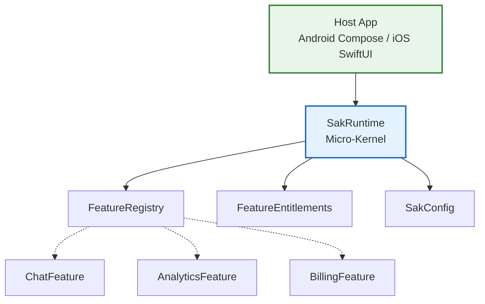
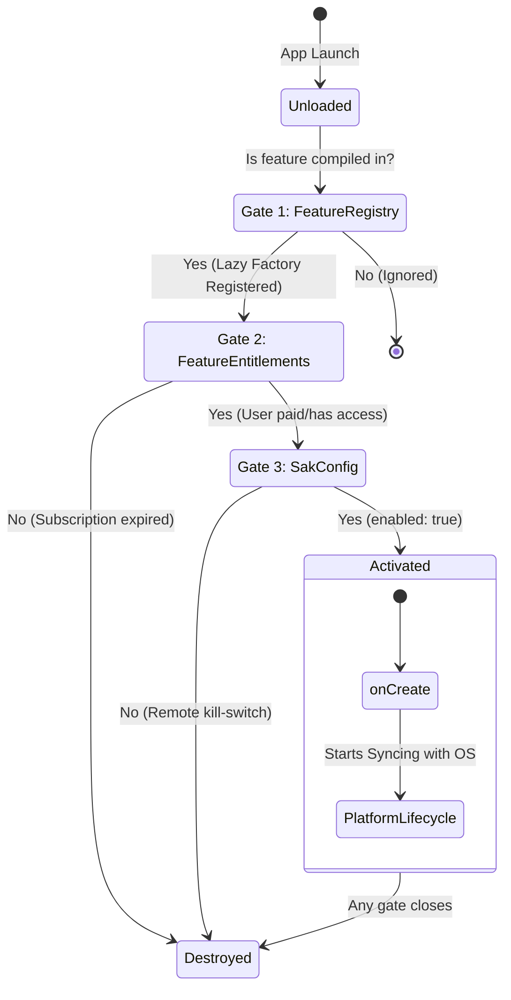
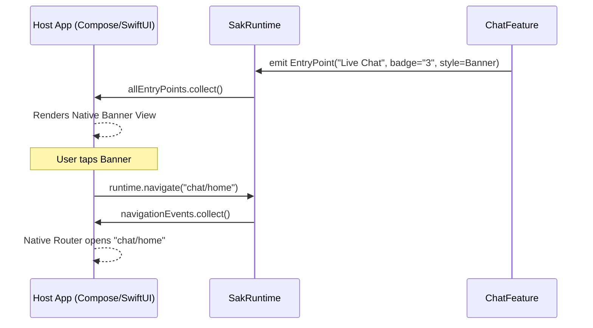

# SAK Architecture & Knowledge Base

The Scalable App Kit (SAK) is a highly decoupled, plugin-based Kotlin Multiplatform (KMP) framework. It is designed to solve the structural problems of massive mobile applications ("Super-Apps"): slow build times, cyclic dependencies, UI framework lock-in, and monolithic state management.

This document serves as the primary knowledge base for the project. It details the **Micro-kernel architecture**, the **Mission & Goals**, the **SOLID principles applied**, **Platform Differences (Android vs iOS)**, and the **Framework Roadmap**.

---

## 1. Core Mission & Objectives

### The Mission
To provide a robust foundation for enterprise applications where independent teams can develop, deploy, and maintain business features as isolated modules with zero compile-time dependencies on each other, while giving the Host Application ultimate control over user experience, navigation, and licensing.

### Key Objectives
1. **Protocol-First Decoupling:** The SDK defines *how* features communicate, not *what* they look like or *where* they appear.
2. **Host-Driven User Experience:** The Host Application owns the top-level layout (Navigation bars, Tabs) and provides "Placeholders" where features plug in their Micro-Frontend widgets (`EntryPoint`).
3. **Reactive Licensing & Entitlements:** Features observe an `ActiveConfig` flow. When a user upgrades their license, features instantly unlock new entry points and internal capabilities without restarting the app.
4. **Resilient Coroutine Lifecycle:** Managed coroutine scopes ensure that a crash or memory leak in one buggy feature cannot crash the entire system.

---

## 2. The Core Philosophy: Micro-Kernel Architecture

SAK is built on a **Micro-Kernel architecture** (often called a Plugin architecture).

*   **The Kernel (`SakRuntime`)**: A lightweight, pure-logic engine in `commonMain`. It knows nothing about your app's business logic, UI, or databases. It only knows how to load, configure, and orchestrate plugins.
*   **The Plugins (`Feature`)**: Independent modules (e.g., `AnalyticsFeature`, `ChatFeature`). They contain the actual business logic.

**SOLID Dependency Inversion:**
In a standard app, `MainActivity` directly imports `ChatManager` and `AnalyticsManager`. In SAK, the Dependency Inversion Principle (DIP) is strictly enforced. The Host App depends on SAK Core, and Features depend on SAK Core. Features **never** directly depend on the Host App or each other.

---

## 3. The 3-Gate Activation Model & Lifecycle

A Feature in SAK consumes zero memory and executes zero code until it passes three distinct runtime gates evaluated by `FeatureManager`. 

### Gate 1: Available (`FeatureRegistry`)
A lazy factory mapping (`FeatureId -> () -> Feature`). Using lambdas ` { AnalyticsFeature() } ` ensures the feature class isn't allocated in memory unless it passes all gates, saving massive amounts of RAM and cutting down App Startup time (TTI).

### Gate 2: Licensed (`FeatureEntitlements`)
A functional interface checking if a user has the right to use the feature. Allows dynamic B2B feature locking without the core SDK needing to know about Google Play Billing or iOS StoreKit. It returns a simple boolean based on the `FeatureId`.

### Gate 3: Enabled (`SakConfig` & `FeatureAccess`)
A JSON-serializable remote config payload. If a feature causes a crash in production, a remote config update flips `enabled: false`, and SAK immediately tears down the feature.
Furthermore, `FeatureAccess` contains a `params: Map<String, JsonElement>` dictionary. This allows the server to pass dynamic configuration (like `"sampling_rate": 0.5`) directly into the feature upon activation.

---

## 4. Feature Observability: Status, State, and Attention

Features publish a `StateFlow<FeatureStatus>` so the host app can monitor their state without polling.

### `FeatureState`: The Health of the Module
*   `Initializing`: The feature is performing heavy I/O in `onCreate`. Host apps usually show a spinner.
*   `Ready`: The feature is healthy and functioning.
*   `Error(message: String)`: The feature caught an exception (e.g., SQLite corruption). The host app observes this and can render a localized Error Card instead of crashing.

### `Attention`: The Urgency of the Module
Features compete for the user's attention. SAK standardizes this via the `Attention` enum:
*   `None`: Standard operation.
*   `Low`: E.g., A subtle red dot on the Chat icon indicating background activity.
*   `Medium`: E.g., A badge with a number ("3 unread messages").
*   `High`: Urgent. E.g., The "Payment Failed" feature requests High attention, prompting the Host App to render a persistent sticky banner at the top of the screen.

---

## 5. UI & Micro-Frontends (The KMP Boundary)

One of the most complex challenges in Kotlin Multiplatform is UI. Android uses Jetpack Compose; iOS uses SwiftUI. 

**The Anti-Pattern:** 
Putting `NavGraphBuilder` or Compose dependencies right into the `commonMain` code breaks iOS compilation.

**The SAK Solution: Micro-Frontends via `EntryPoint`**
SAK treats UI as "Server-Driven UI" where the "Server" is just the local Feature Module.
*   Features do **not** draw screens. They emit `EntryPoint` data structures.
*   An `EntryPoint` is descriptive: semantic types (`Dashboard`, `Alert`, `Settings`), style hints (`Card`, `Row`, `Banner`), badges, icons, and actions.
*   The Host App observes `SakRuntime.allEntryPoints` and natively draws Compose Cards or SwiftUI Views.

---

## 6. Platform Architecture: Android vs. iOS

| Architectural Concept | Android (Jetpack Compose) | iOS (SwiftUI + `SakIosBridge`) |
| :--- | :--- | :--- |
| **Host Container** | `ComponentActivity` / `NavHost` | `UIWindow` / `NavigationStack` |
| **Lifecycle Integration** | `LocalLifecycleOwner.current.lifecycle` | `SakIosHost.onScenePhaseActive/Inactive()` |
| **Navigation Event Collector** | `LaunchedEffect { runtime.navigationEvents.collect { ... } }` | `sakHost.observeNavigation { route in navPath.append(route) }` |
| **UI Rendering** | `LazyColumn` / `Card` from `allEntryPoints` | `ScrollView` / `VStack` driven by `SakIosHost.queryEntryPoints()` |

---

## 7. Inter-Process Communication (The Service Locator)

SAK uses a strict **Service Locator Pattern** (`FeatureService` & `ServiceLookup`).
1.  `CoreFeature` implements a public `LoggerApi` interface. In its `services()` function, it registers the implementation.
2.  `SakRuntime` collects all exported services into a global `ServiceRegistry`.
3.  `AnalyticsFeature` boots up. It asks its `FeatureContext`: `val logger = context.services.get<LoggerApi>()`.

This guarantees **zero compile-time coupling** between sibling feature modules. If `CoreFeature` is disabled remotely, `get<LoggerApi>()` safely returns `null`.

---

## 8. Concurrency & Performance Optimizations

1. **Preventing Mutex Starvation:** `FeatureManager.apply()` calculates activation diffs inside a 0.1ms `Mutex` lock, but dispatches `onCreate()` / `onDestroy()` suspend functions concurrently outside the lock using `scope.launch`.
2. **O(1) Flow Aggregation:** `SakRuntime.allEntryPoints` and `allStatuses` use a `Mutex`-backed concurrent `Map` to update only changed feature entries, avoiding $O(N)$ `combine(vararg)` array allocations.
3. **Zero-Allocation Primitives:** Domain IDs (`FeatureId`, `EntryPointId`, `Route`) use `@JvmInline value class` for compile-time type safety with zero runtime heap allocation.
4. **Exactly-Once Event Streams:** Navigation uses a `Channel<Route>(BUFFERED)` exposed via `receiveAsFlow()`, completely eliminating Compose recomposition "double-navigation" bugs.

---

## 9. Framework Roadmap

### 🛠️ Phase 1: Robustness & Developer Experience
*   [x] Non-blocking concurrent feature activation.
*   [x] Zero-allocation `@JvmInline` domain IDs.
*   [x] Built-in `DebugDashboardScreen` for SAK architecture observability.
*   [x] Consolidated KDocs and Mermaid documentation.

### 🏗️ Phase 2: Core Evolution
*   [ ] **KSP Feature Auto-Discovery:** Generate `FeatureRegistry` automatically using Kotlin Symbol Processing (`@SakFeature` annotation).
*   [ ] **Type-Safe Navigation Contracts:** Replace string-based routes with compile-time checked Kotlin `RouteContract` objects.
*   [ ] **DI Framework Bridges:** Official bridge utilities for Koin and Hilt inside features.

### 🚀 Phase 3: Platform Expansion
*   [ ] **SwiftUI Native View Macros:** Expand `SakIosBridge` for Swift 6 macros.
*   [ ] **Compose Desktop & Wasm Support:** Target WebAssembly and Desktop (JVM) targets for universal multiplatform super-apps.

---

## 10. File-by-File Reference

### `sak.sdk.feature`
*   **`Feature.kt`**: Core plugin contract. Implements `LifecycleOwner`.
*   **`BaseFeature.kt`**: Abstract implementation handling `LifecycleRegistry` and state flows.
*   **`FeatureContext.kt`**: The sandbox injected into features (Scope, Navigation, Services).
*   **`FeatureTypes.kt`**: `@JvmInline` IDs, `FeatureState`, `FeatureStatus`.

### `sak.sdk.entry`
*   **`EntryPoint.kt`**: The Micro-Frontend UI descriptor.
*   **`EntryTypes.kt`**: `@JvmInline EntryPointId`, enums for layout hints (`EntryStyle`, `EntryPointType`), and `EntryAction`.

### `sak.sdk.service`
*   **`FeatureService.kt`**: Container mapping a `KClass` interface to an implementation.
*   **`ServiceLookup.kt`**: The Service Locator interface with a reified `get<T>()` extension.

### `sak.sdk.config` & `sak.sdk.license`
*   **`SakConfig.kt`**: The JSON payload controlling the runtime state.
*   **`FeatureAccess.kt`**: The enablement boolean and remote config `params`.
*   **`FeatureEntitlements.kt`**: Functional interface for Gate #2 (Licensing).

### `sak.runtime`
*   **`SakRuntime.kt`**: Public engine facade. Merges configs, hosts the exact-once Navigation Channel, and aggregates EntryPoint flows.
*   **`FeatureManager.kt`**: Internal orchestrator. Evaluates the 3 Gates, proxies Host OS lifecycle events (e.g., `ON_STOP`), and safely bootstraps features concurrently.
*   **`FeatureRegistry.kt`**: Gate #1. Stores lazy factories of compiled features.
*   **`ServiceRegistry.kt`**: Internal backing for `ServiceLookup`, merging Host-provided and Feature-provided APIs.
