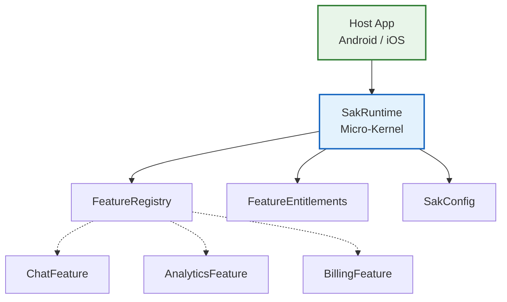
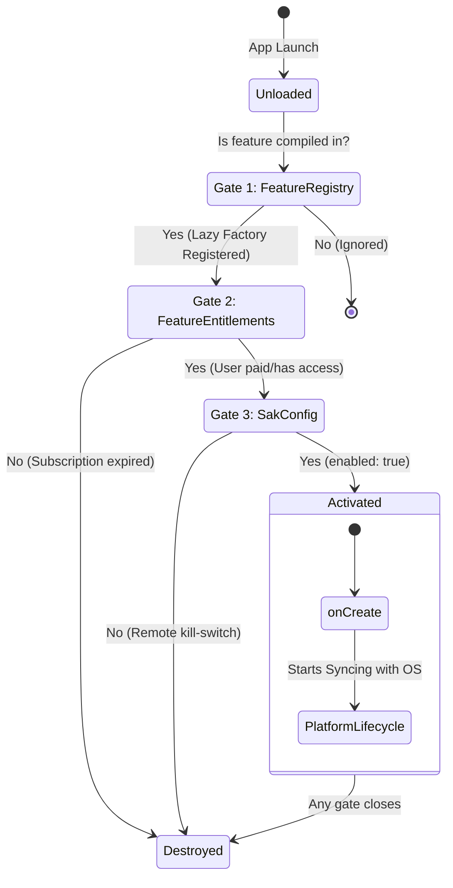
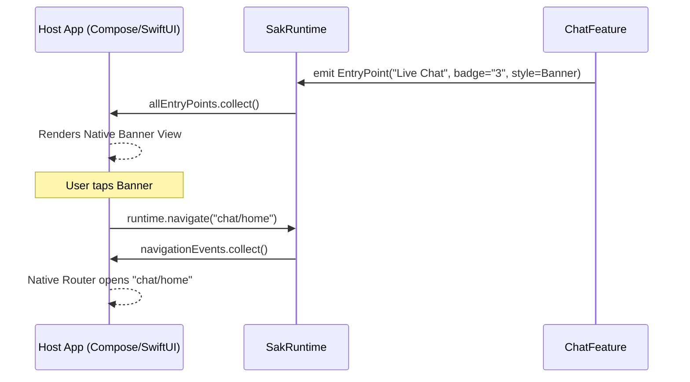

# SAK Architecture & Knowledge Base

The Scalable App Kit (SAK) is a highly decoupled, plugin-based Kotlin Multiplatform (KMP) framework. It is designed to solve the structural problems of massive mobile applications: slow build times, cyclic dependencies, UI framework lock-in, and monolithic state management.

This document serves as the primary knowledge base for the project. It details the **Micro-kernel architecture**, the **SOLID principles** applied, and the exact reasoning behind every major technical decision.

---

## 1. The Core Philosophy: Micro-Kernel & Plugin Architecture

SAK is built on a **Micro-Kernel architecture** (often called a Plugin architecture).
*   **The Kernel (`SakRuntime`)**: A lightweight, pure-logic engine. It knows nothing about your app's business logic, UI, or databases. It only knows how to load, configure, and orchestrate plugins.
*   **The Plugins (`Feature`)**: Independent modules (e.g., `AnalyticsFeature`, `ChatFeature`). They contain the actual business logic.

**Why this is the best approach:**
In a standard app, `MainActivity` directly imports `ChatManager` and `AnalyticsManager`. As the app grows, every feature becomes entangled. In SAK, the Dependency Inversion Principle (DIP) is strictly enforced. The Host App depends on the SAK Core, and Features depend on the SAK Core. Features **never** directly depend on the Host App or each other.

---

## 2. The 3-Gate Activation Model & Lifecycle

A Feature in SAK consumes zero memory and executes zero code until it passes three distinct runtime gates evaluated by `FeatureManager`. 

### Gate 1: Available (`FeatureRegistry`)
A lazy factory mapping (`FeatureId -> () -> Feature`). Using lambdas ` { AnalyticsFeature() } ` ensures the feature class isn't allocated in memory unless it passes all gates, saving massive amounts of RAM and cutting down App Startup time (TTI).

### Gate 2: Licensed (`FeatureEntitlements`)
A functional interface checking if a user has the right to use the feature. Allows dynamic B2B feature locking without the core SDK needing to know about Google Play Billing or iOS StoreKit. It returns a simple boolean based on the `FeatureId`.

### Gate 3: Enabled (`SakConfig` & `FeatureAccess`)
A JSON-serializable remote config payload. If a feature causes a crash in production, a remote config update flips `enabled: false`, and SAK immediately tears down the feature.
Furthermore, `FeatureAccess` contains a `params: Map<String, JsonElement>` dictionary. This allows the server to pass dynamic configuration (like "sampling_rate": 0.5) directly into the feature upon activation.

---

## 3. Feature Observability: Status, State, and Attention

Unlike monolithic apps where the UI has to constantly poll the database to know if a feature is broken, SAK features are inherently observable. Features publish a `StateFlow<FeatureStatus>`.

### `FeatureState`: The Health of the Module
*   `Initializing`: The feature is performing heavy I/O in `onCreate`. Host apps usually show a spinner.
*   `Ready`: The feature is healthy and functioning.
*   `Error(message: String)`: The feature caught an exception (e.g., SQLite corruption). The host app observes this and can render a localized Error Card instead of crashing.

### `Attention`: The Urgency of the Module
Features compete for the user's attention. SAK standardizes this via the `Attention` enum:
*   `None`: Standard operation.
*   `Low`: E.g., A subtle red dot on the Chat icon indicating background activity.
*   `Medium`: E.g., A badge with a number ("3 unread messages").
*   `High`: Urgent. E.g., The "Payment Failed" feature requests High attention, prompting the Host App to render a persistent sticky banner at the top of the screen.

---

## 4. UI & Micro-Frontends (The KMP Boundary)

One of the most complex challenges in Kotlin Multiplatform is UI. Android uses Jetpack Compose; iOS uses SwiftUI. 

**The Anti-Pattern:** 
Many SDKs try to build an abstraction over Compose and SwiftUI, or they force Compose Multiplatform (CMP) everywhere. Worse, they put `NavGraphBuilder` right into the `commonMain` code, immediately breaking iOS compilation.

**The SAK Solution: Micro-Frontends via `EntryPoint`**
SAK treats UI as "Server-Driven UI" where the "Server" is just the local Feature Module.
*   Features do **not** draw screens. They emit `EntryPoint` data structures.
*   An `EntryPoint` is incredibly descriptive. It contains semantic types (`Dashboard`, `Alert`, `Settings`), style hints (`Card`, `Row`, `Banner`), badges, icons, and actions.
*   The Host App observes `SakRuntime.allEntryPoints`. It sees the data and natively draws Compose Cards or SwiftUI Views.

**Advanced UI via `Metadata`**
If an `EntryPoint` needs to show a complex graph, it doesn't pass UI code. It passes pure data. The `EntryPoint` has a `metadata: Map<String, JsonElement>` field. A feature can inject `"graph_data": [10, 50, 30]`, and the Host App's custom Card renderer can read that JSON and draw a beautiful SwiftUI LineChart.

---

## 5. Inter-Process Communication (The Service Locator)

If features are decoupled, how does `AnalyticsFeature` log a message if `CoreFeature` owns the Logger?

**The Anti-Pattern:**
`AnalyticsFeature` adds a Gradle `implementation(project(":core-feature"))`. This creates tightly coupled build graphs and eventually leads to circular dependency build failures.

**The SAK Solution: `FeatureService` and `ServiceLookup`**
SAK uses a strict **Service Locator Pattern**.
1.  `CoreFeature` implements a public `LoggerApi` interface. In its `services()` function, it registers the implementation.
2.  `SakRuntime` collects all exported services into a global `ServiceRegistry`.
3.  `AnalyticsFeature` boots up. It asks its `FeatureContext`: `val logger = context.services.get<LoggerApi>()`.

*Why it's the best:* Zero compile-time coupling between sibling features. If `CoreFeature` is disabled remotely, `get<LoggerApi>()` safely returns `null`. Features can gracefully degrade instead of crashing the app.

---

## 6. Event Streams vs. State Streams (Navigation)

**The Anti-Pattern:**
Using `MutableStateFlow` for navigation events (e.g., `val currentRoute: StateFlow<Route>`). `StateFlow` holds its last value and replays it to new subscribers. If the user rotates their phone, the UI recomposes, re-subscribes to the `StateFlow`, receives the same route again, and crashes the app with a "double navigation" exception.

**The SAK Solution: `Channel<Route>`**
`SakRuntime` uses a `Channel(BUFFERED)` exposed as a `Flow<Route>`. 
A Channel is a *hot stream of one-shot events*. When `HarnessApp` collects the route, the event is permanently removed from the queue. Exactly-once delivery guarantees perfectly stable navigation in Compose and SwiftUI.

---

## 7. Concurrency & Performance Optimizations

### A. Preventing Mutex Starvation
During configuration updates, `FeatureManager.apply()` must determine which features to start and stop. 
Originally, this ran entirely inside a `Mutex` lock. If a feature's `onCreate()` took 2 seconds to query a database, the entire SDK locked up.
**Optimization:** We refactored `FeatureManager` to compute the "diff" (what to start/stop) inside the lock (taking 0.1ms), but dispatch the actual `onCreate()` and `onDestroy()` suspend functions concurrently outside the lock via `scope.launch`. Features now bootstrap in parallel.

### B. O(1) Flow Aggregation (Avoiding `combine` overhead)
`SakRuntime` exposes `allEntryPoints` and `allStatuses`. 
Originally, this used Coroutines' `combine()` operator over an array of all active feature flows. In Kotlin, `combine` re-allocates a new array and re-evaluates *every* item whenever a *single* item changes. For 50 features, this is $O(N)$ overhead per tick.
**Optimization:** We replaced `combine` with a targeted `Mutex`-backed `Map`. When `AnalyticsFeature` updates its badge, SAK updates *only* the `Analytics` key in the map, and re-emits. This reduces aggregation overhead to $O(1)$.

### C. Zero-Allocation Primitives (`@JvmInline value class`)
IDs like `FeatureId`, `EntryPointId`, and `Route` are passed around thousands of times a minute in a busy UI. Using standard `data class` wrappers causes extreme heap churn and Garbage Collection stutter.
**Optimization:** SAK uses `@JvmInline value class FeatureId(val value: String)`. At compile-time, developers get strict type safety (you cannot pass a `String` into a `FeatureId` slot). At runtime, the JVM completely erases the class and uses raw `String`s, resulting in zero memory allocations.
